# Proyecto 1 · Mi web en AWS — Librería Tinta

Alumno: Artur Balayan

Despliegue de la web de **Librería Tinta** en AWS (Learner Lab, región `us-east-1`) dentro de una red propia creada desde la consola.

Vídeo: _(pendiente de añadir el enlace)_

## Diagrama de la arquitectura

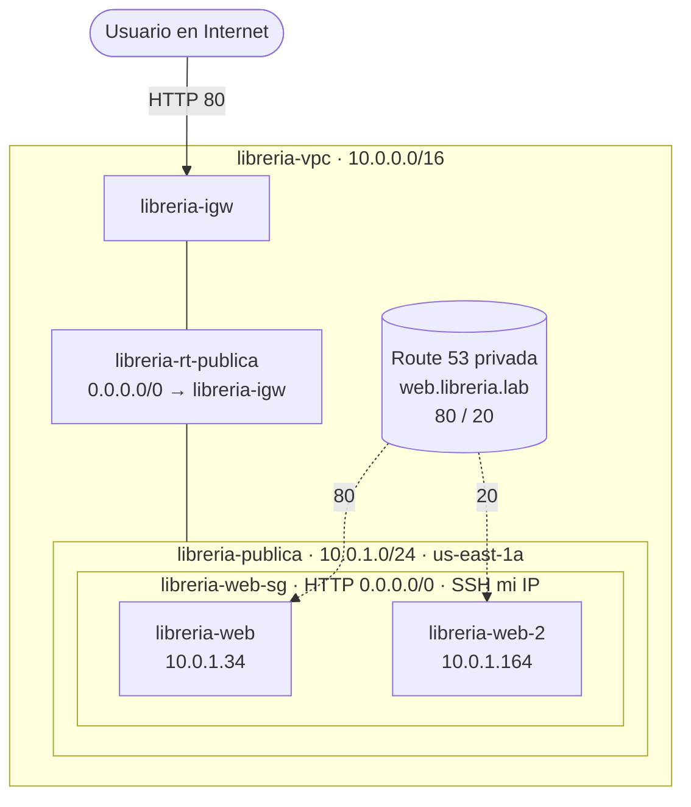

## Nivel básico

### B1. La red

| Recurso | Nombre | Configuración |
|---|---|---|
| VPC | `libreria-vpc` | 10.0.0.0/16, resolución y nombres de host DNS activados |
| Subred pública | `libreria-publica` | 10.0.1.0/24, us-east-1a, IP pública automática |
| Gateway de internet | `libreria-igw` | Asociada a `libreria-vpc` |
| Tabla de rutas | `libreria-rt-publica` | 0.0.0.0/0 → `libreria-igw`, asociada a `libreria-publica` |

Cada recurso se creó por separado (sin el asistente «VPC y más»).

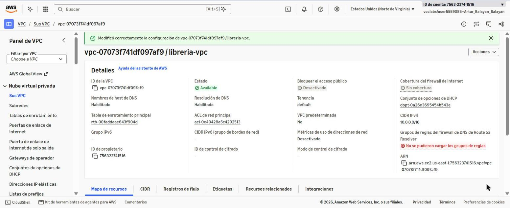
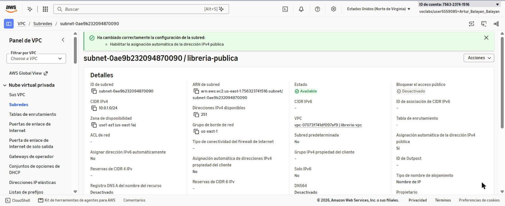
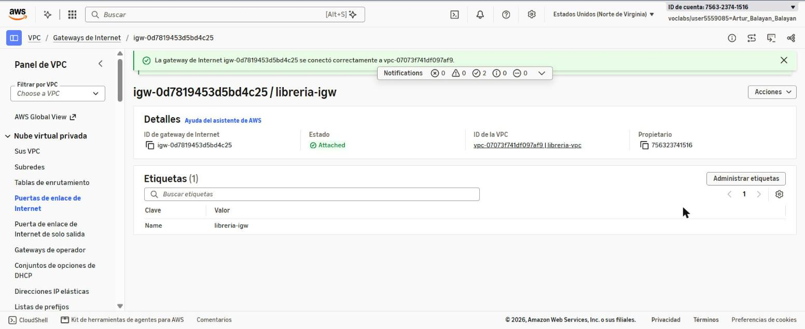
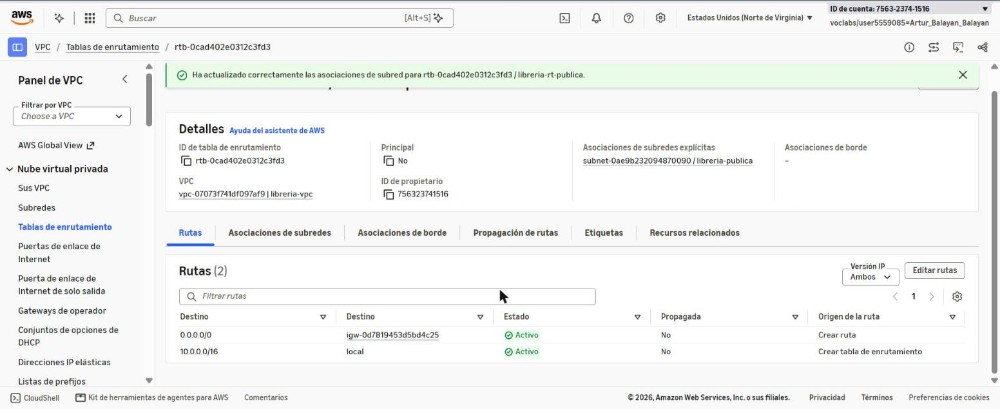

**¿Por qué la subred es pública?** Porque su tabla de rutas envía todo el tráfico que no es de la VPC (0.0.0.0/0) a la gateway de internet y además asigna IP pública a las instancias; sin esas dos cosas nadie desde fuera podría llegar a la web.

### B2. La seguridad

Grupo `libreria-web-sg` en `libreria-vpc`:

| Tipo | Puerto | Origen |
|---|---|---|
| HTTP | 80 | 0.0.0.0/0 |
| SSH | 22 | 213.0.87.102/32 (Mi IP) |

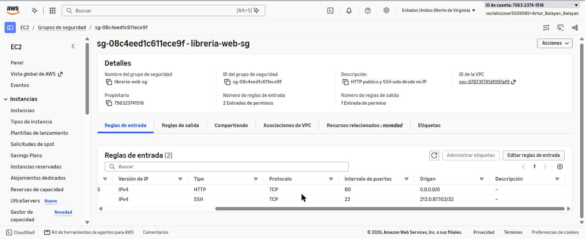

**¿Por qué SSH solo a mi IP?** La web tiene que verla cualquiera, pero el puerto 22 da acceso de administración al servidor. Abrirlo a todo Internet expone la máquina a ataques de fuerza bruta; limitándolo a mi IP solo yo puedo intentar conectarme.

### B3. El servidor web

Instancia `libreria-web`: Amazon Linux 2023, `t3.micro`, par de claves `vockey`, en `libreria-vpc` / `libreria-publica` / `libreria-web-sg`, etiquetas `Proyecto = P1` y `Alumno = Artur Balayan`, con [scripts/user-data1.sh](scripts/user-data1.sh) como datos de usuario.

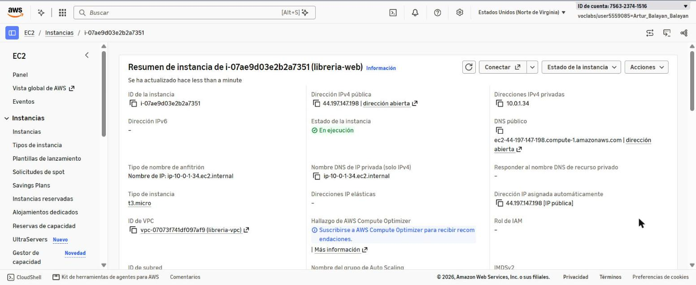
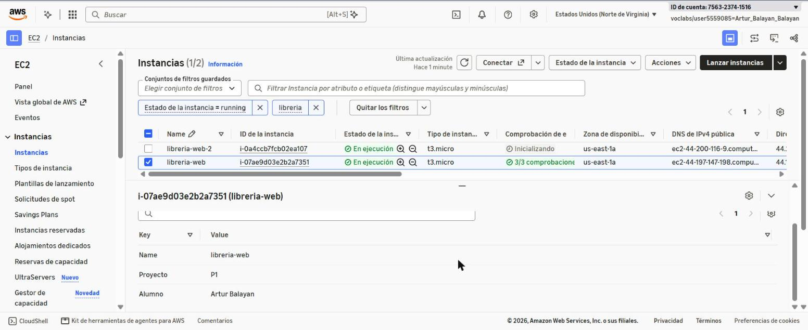

Web funcionando en `http://44.197.147.198` (con la IP en la barra de direcciones):

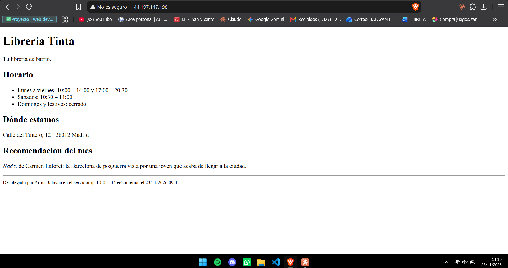

### B4. Presupuesto

Estimación para un servidor encendido 24/7 en us-east-1 (730 h/mes):

| Concepto | Cálculo | €/mes (USD) |
|---|---|---|
| EC2 t3.micro Linux bajo demanda | 0,0104 $/h × 730 h | 7,59 $ |
| EBS gp3 8 GB | 8 GB × 0,08 $/GB | 0,64 $ |
| IPv4 pública | 0,005 $/h × 730 h | 3,65 $ |
| **Total** | | **≈ 11,88 $/mes** |

Enlace de la estimación en AWS Pricing Calculator: _(pendiente)_

Para abaratarlo se podría apagar la instancia fuera del horario de la librería o contratar un Savings Plan / instancia reservada a 1 año, que reduce bastante el precio por hora.

## Nivel medio

### M1. Segunda web y DNS ponderado

Segunda instancia `libreria-web-2` con la misma VPC, subred y grupo de seguridad, y [scripts/user-data2.sh](scripts/user-data2.sh) para que se reconozca como el servidor 2.

| Servidor | IP pública | IP privada |
|---|---|---|
| libreria-web | 44.197.147.198 | 10.0.1.34 |
| libreria-web-2 | 44.200.116.9 | 10.0.1.164 |

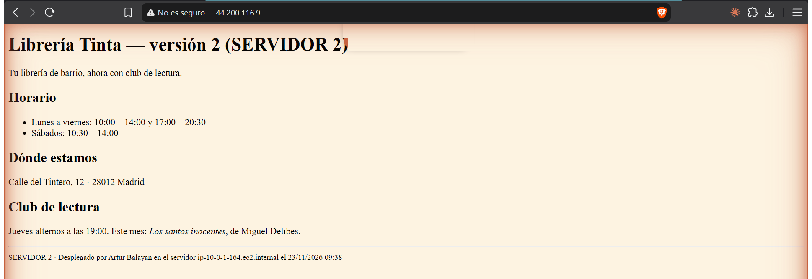

Zona alojada **privada** `libreria.lab` asociada a `libreria-vpc`, con dos registros A ponderados para `web.libreria.lab`:

| Nombre | Tipo | Peso | ID de registro | Valor |
|---|---|---|---|---|
| web.libreria.lab | A | 80 | servidor-1 | 10.0.1.34 |
| web.libreria.lab | A | 20 | servidor-2 | 10.0.1.164 |

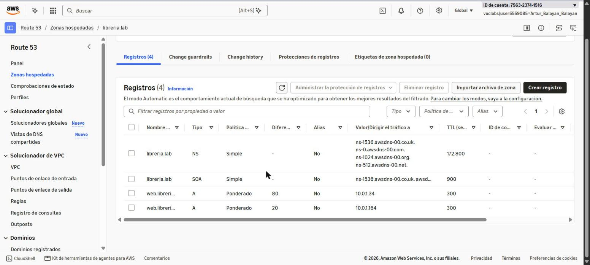

Pendiente: comprobar la resolución con `dig`/`nslookup` y las peticiones con `curl` desde una de las instancias, y actualizar el presupuesto (M2).

## Uso de IA

- **Herramienta:** Claude (Claude Code), que manejó la consola de AWS desde el navegador y preparó los scripts y este README.
- **Prompts útiles:**
  - «Lee el enunciado del proyecto y haz un resumen paso a paso de que tengo que hacer.»
  - «Personaliza el user data con horario, dirección y una recomendación de libro, y haz una versión 2 reconocible.»
  - «Quiero que me crees un README donde escribas todos los datos y capturas que pide el enunciado.»
- **Error detectado:** al rellenar el CIDR de la subred, el atajo para seleccionar todo el texto no funcionó y el campo quedó como `a10.0.1.0/24`. Lo vi en la captura antes de crear la subred, borré el campo y escribí `10.0.1.0/24` de nuevo. Además, el asistente de lanzamiento propone por defecto la VPC predeterminada y crear un grupo `launch-wizard`; hubo que cambiarlo a mano a `libreria-vpc` y `libreria-web-sg`.
